<div align="center">

<picture>
  <source media="(prefers-color-scheme: dark)" srcset="docs/assets/banner-dark.svg">
  <source media="(prefers-color-scheme: light)" srcset="docs/assets/banner-light.svg">
  
</picture>

<p>
  <strong>A from-scratch reimplementation of the Portal 2 engine in Rust and Bevy<br>that plays <em>your own copy</em> of the game.</strong>
</p>

<p>
  <a href="https://github.com/cozmoe0/portal2rust/actions/workflows/ci.yml"></a>
  
  
  
  
  <br>
  
  
  
</p>

<p>
  <a href="#-whats-inside">What's inside</a> •
  <a href="#-gallery">Gallery</a> •
  <a href="#-side-by-side-with-the-original">Parity</a> •
  <a href="#-quick-start">Quick start</a> •
  <a href="#-architecture">Architecture</a> •
  <a href="#-how-it-was-built">How it was built</a> •
  <a href="#-status">Status</a> •
  <a href="#-development">Development</a>
</p>

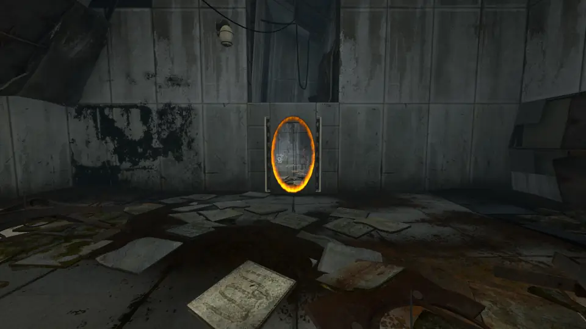
<br>
<sub><em>Recorded in portal2rust from the author's copy of Portal 2: the first chamber's portal hop, a walk through the pair and the view back through it.</em></sub>

</div>

---

**portal2rust** is a new engine for Portal 2, in the spirit of [OpenMW](https://openmw.org) and
[OpenRCT2](https://openrct2.io). It reads the maps, models, materials, textures, sounds, particle
systems, scripts and interface files of a Portal 2 installation you own, and runs them the way the
original does: the same server tick, the same entity I/O, the same movement rules, the same sound
operator stacks, the same VGUI layouts drawn with the same fonts. Nothing from the game ships with
this repository.

<table>
<tr>
<td width="33%" valign="top">

**🎮 Your own copy**<br>
Every asset is read from your Steam install at runtime: VPKs, BSPs, models, sounds, scripts.
Without the game there is nothing to run.

</td>
<td width="33%" valign="top">

**🧪 Clean-room engine**<br>
All 68k lines are original Rust. Reverse engineering was used for facts (constants, defaults,
file layouts), never to translate code.

</td>
<td width="33%" valign="top">

**🎯 Faithful by measurement**<br>
A parity harness captures the same views in the real game and in ours and diffs them; campaign
runs check every level transition.

</td>
</tr>
</table>

## ✨ What's inside

<table>
<tr>
<td width="50%" valign="top">

&nbsp;**Source rendering on Bevy**<br>
Lightmapped brushes and displacements with blend-modulated floors, studio models with ambient cubes,
overlays, the 2D sky and 3D sky box, ropes, sprites and glows, spotlight beams, flowing goo and water,
refracting glass, projected-texture shadows and the game's dynamic tone mapping.

&nbsp;**Portals**<br>
Placement that fits, nudges and snaps like the game's, recursive portal views with the game's rim,
static and opening shader, and travel that carries momentum and turns falls into flings.

&nbsp;**Movement, physics and devices**<br>
The player's air control and funneling, carrying, faith plates with exact arcs, hard light bridges,
excursion funnels, lasers and catchers, fizzlers, and floor turrets with their thinks and voices.

&nbsp;**Gels**<br>
A paint map on the lightmap atlas, sprayers and blobs, paint bombs, painted props and the bounce,
speed and portal gel rules.

&nbsp;**Particle systems**<br>
The game's own `.pcf` effects run on reimplemented operators with the defaults read from the game,
drawn as SpriteCard sprites with texture sheets.

&nbsp;**Bink video**<br>
A pure Rust Bink 1 decoder plays the intro, the menu backgrounds and the elevator screens.

</td>
<td width="50%" valign="top">

&nbsp;**Sound and dialogue**<br>
Sound scripts, operator stacks and mixers with ducking under dialogue, soundscapes, footsteps, and
choreographed scenes from `scenes.image` with close captions.

&nbsp;**VScript**<br>
A Squirrel 2.2 interpreter written from the language reference, with the game's VScript bindings,
runs every map script; tables keep the original slot layout, so iteration order matches.

&nbsp;**The game's interface**<br>
VGUI schemes, `.res` layouts and fonts rasterized with GDI like the game: main menu, chapter select,
loading screens, pause menu, HUD, instructor hints and the ending credits.

&nbsp;**Saved games**<br>
Save, load, quick saves, autosaves, dangerous autosaves and reload after death, with the map's
entities, the script VM and the player restored slot for slot.

&nbsp;**The developer console**<br>
Console variables with the game's defaults, commands, aliases, binds, `exec`, and the startup
sequence through your own `config.cfg`.

&nbsp;**Readers for Source formats**<br>
VPK, BSP, MDL/VVD/VTX/PHY, VTF, VMT, KeyValues, FGD, PCF/DMX, VCD and `scenes.image`, WAV, sound
scripts, soundscapes and captions, all engine-agnostic.

</td>
</tr>
</table>

## 🖼 Gallery

<table>
<tr>
<td width="50%">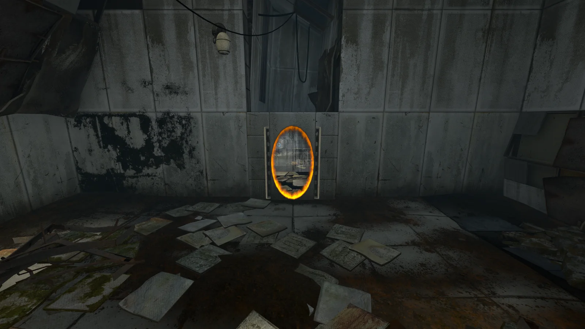<br><sub>A linked portal pair, drawn with the rim, static and opening of the game's compiled portal shader</sub></td>
<td width="50%">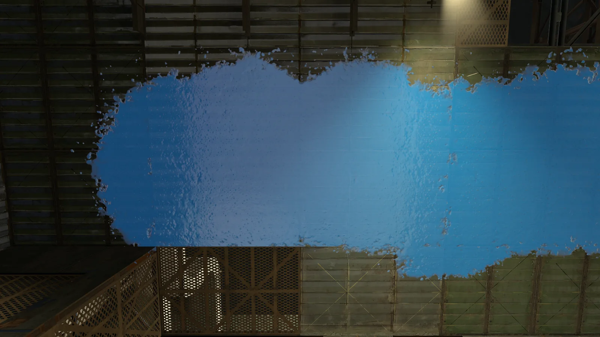<br><sub>Repulsion gel on a wall, painted into the paint map on the lightmap atlas</sub></td>
</tr>
<tr>
<td width="50%">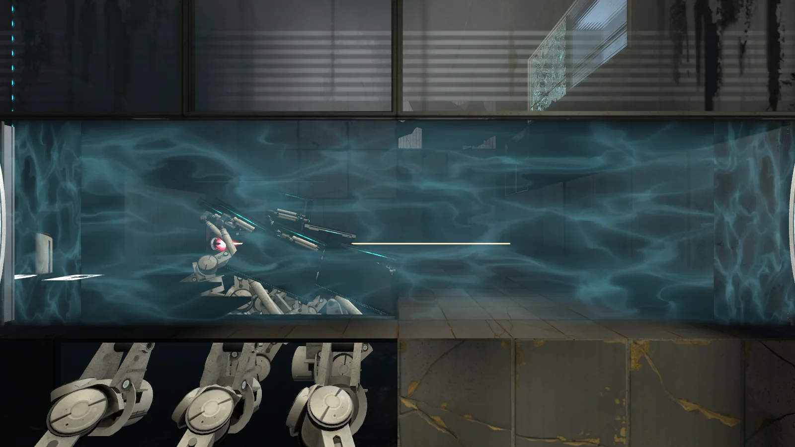<br><sub>An emancipation grill, a turret and its laser sight</sub></td>
<td width="50%">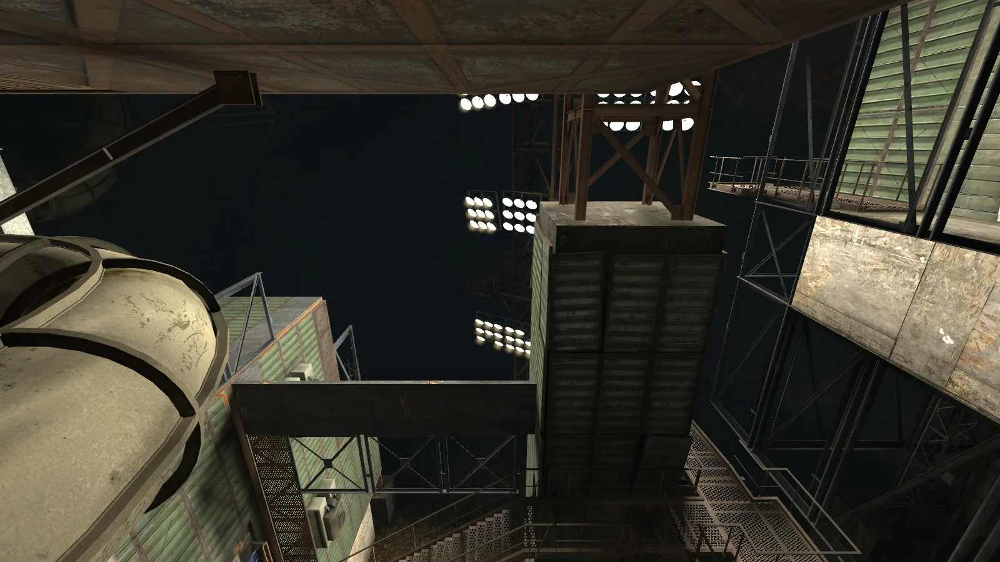<br><sub>Floodlights and gantries deep in the facility</sub></td>
</tr>
<tr>
<td width="50%">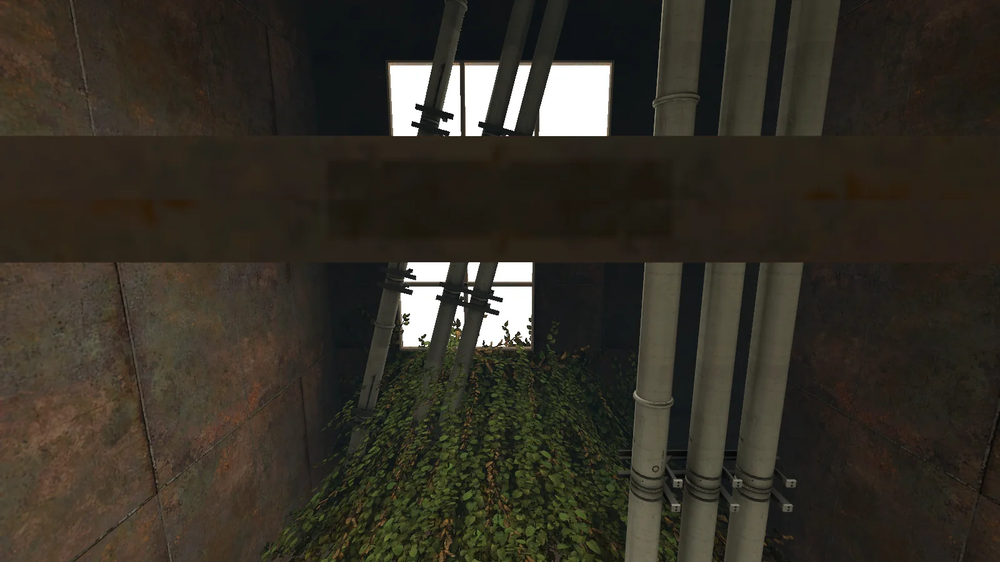<br><sub>Daylight through a vine-choked shaft</sub></td>
<td width="50%">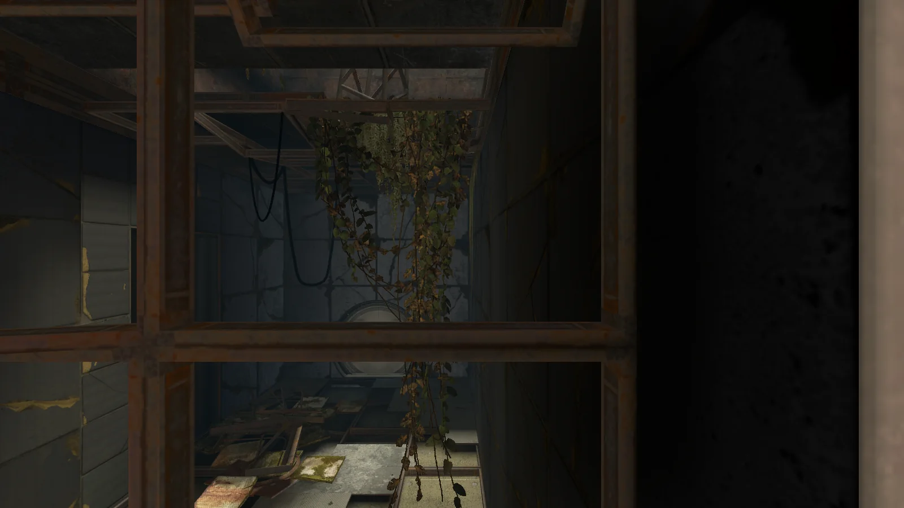<br><sub>A ruined, overgrown chamber, with the game's particle drips</sub></td>
</tr>
</table>

<sub>Screenshots show portal2rust running the author's own copy of Portal 2. Portal 2 and all of
its content are © Valve Corporation.</sub>

## 🔍 Side by side with the original

The parity harness takes the same view in the original game (driven over its network console) and in
portal2rust, then compares them. Each image below is one view split down the middle: the original game on one
side, portal2rust on the other.

<table>
<tr>
<td width="50%">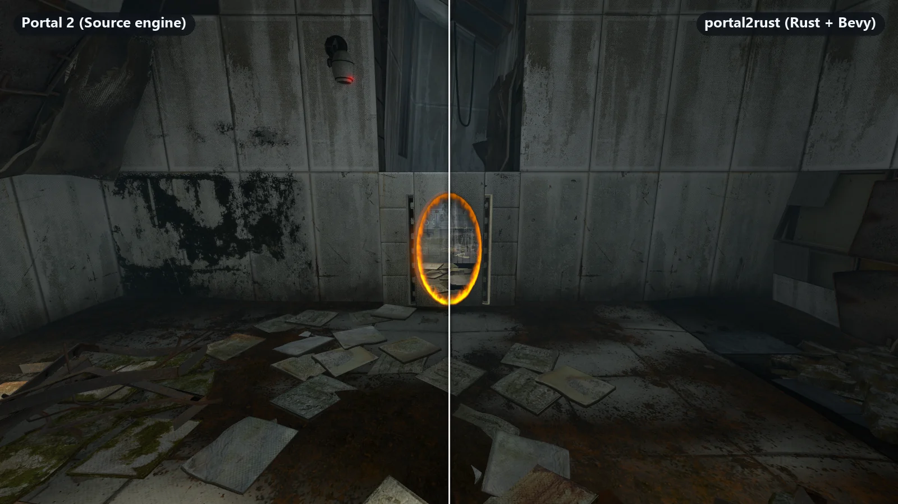<br><sub>Portals: the opening, its rim and the view through it</sub></td>
<td width="50%">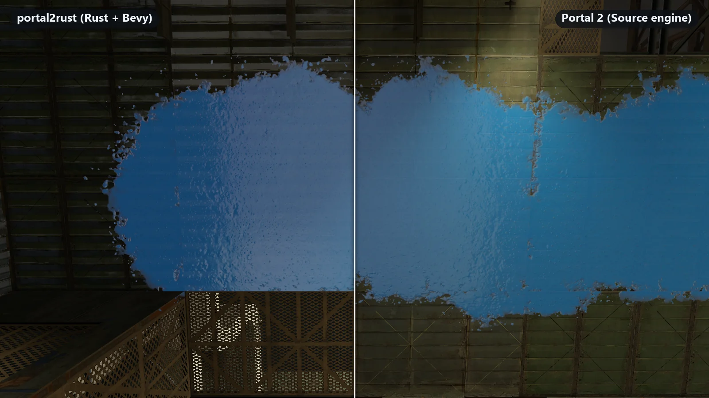<br><sub>Gels (portal2rust on the left here)</sub></td>
</tr>
<tr>
<td width="50%">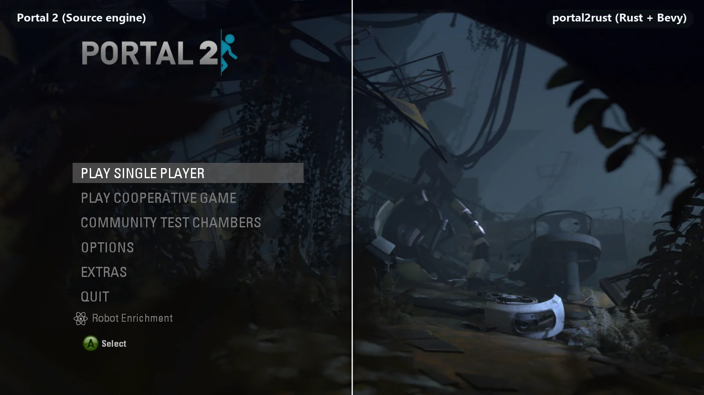<br><sub>The main menu: layout, fonts and blending</sub></td>
<td width="50%">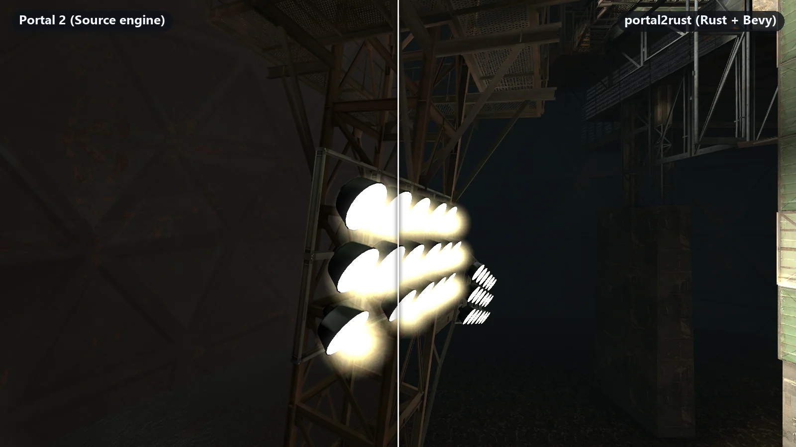<br><sub>Floodlight sprites and glows</sub></td>
</tr>
</table>

## 🚀 Quick start

You need [Rust](https://rustup.rs) (stable, 2024 edition) and Portal 2 installed through Steam.

```bash
git clone https://github.com/cozmoe0/portal2rust
cd portal2rust
cargo run --release -p portal2
```

The game starts like the original: the intro video, then the main menu over its background movie.
Pass a map to go straight into it:

```bash
cargo run --release -p portal2 -- sp_a2_laser_intro
```

The installation is found in the default Steam library, any library listed in Steam's
`libraryfolders.vdf`, or the folder given by `PORTAL2_DIR` (the one that contains `portal2.exe`).
Controls come from your own `portal2/cfg/config.cfg`; `Esc` opens the pause menu, `` ` `` the
console, `V` toggles noclip. An optional [visual overhaul](docs/visual_overhaul.md) (real-time
portal and laser light, wet reflections, volumetric light, bloom) is on by default;
`r_fx_preset 0` (or `--fx off`) gives the faithful picture.

<details>
<summary><strong>Command-line options</strong></summary>

| Option | Meaning |
| --- | --- |
| `<map>` / `--map <map>` | Map to load, e.g. `sp_a1_intro3` (none: start at the main menu) |
| `-novid` / `-nomenuvid` | Skip the intro video / show the menu background still instead of the movie |
| `--pos x,y,z` / `--ang p,y,r` | Override the start view (Source units / degrees) |
| `--exposure <scale>` | Fixed exposure instead of the dynamic tone map |
| `--fx off\|medium\|high\|ultra` | The [visual overhaul](docs/visual_overhaul.md)'s preset (default ultra; off is the faithful picture) |
| `--fullbright` | Ignore lighting (debugging) |
| `--noclip` | Start in free flight |
| `--portalgun none\|blue\|both` | Override the portal gun |
| `+command args` | Console command run once the first map has loaded, e.g. `+sv_cheats 1 +setpos 0 0 64` |
| `--nosound` | No audio output |
| `--snd-record <file.wav> [--snd-seconds n]` | Also write the first `n` seconds of the mix to a WAV file |
| `--screenshot <file> --frames <n>` | Capture a screenshot after `n` frames and exit |
| `--shots <file>` | Visit each view of a shot list and save `re/out/ours/<name>.png` |
| `--bench <file>` | Visit each view of a shot list and append frame-time statistics to `re/out/bench.txt` |
| `--record <dir>` | Save every frame of `--record-seconds` of play, `--record-fps` frames per second of game time |
| `--autopilot f2,j,w1` | Scripted input (`f/b/l/r` move, `j` jump, `t` turn, `a` look at, `1`/`2` fire, `e` use, `w` wait) |
| `--spawn class@x,y,z` | Spawn an entity after the map loads (repeatable) |
| `--smoke sp\|<maps>` | Run each map briefly and write `re/out/smoke.txt` (script errors, unhandled inputs) |
| `--chain <map>` | Take every level's exit through the campaign; writes `re/out/chain.txt` |
| `--save-test <maps>` | Check that saving, loading and saving again gives the same save |
| `--io-debug` / `--probe` | Log every entity output / what the view ray hits |

</details>

## 🏗 Architecture

The engine is a Cargo workspace of small crates with a strict layering: the three format crates
know nothing about Bevy, `portal2_core` holds what every system shares, the engine crates build on
it side by side, and `portal2_game` brings them together into Portal 2.

<picture>
  <source media="(prefers-color-scheme: dark)" srcset="docs/assets/architecture-dark.svg">
  <source media="(prefers-color-scheme: light)" srcset="docs/assets/architecture-light.svg">
  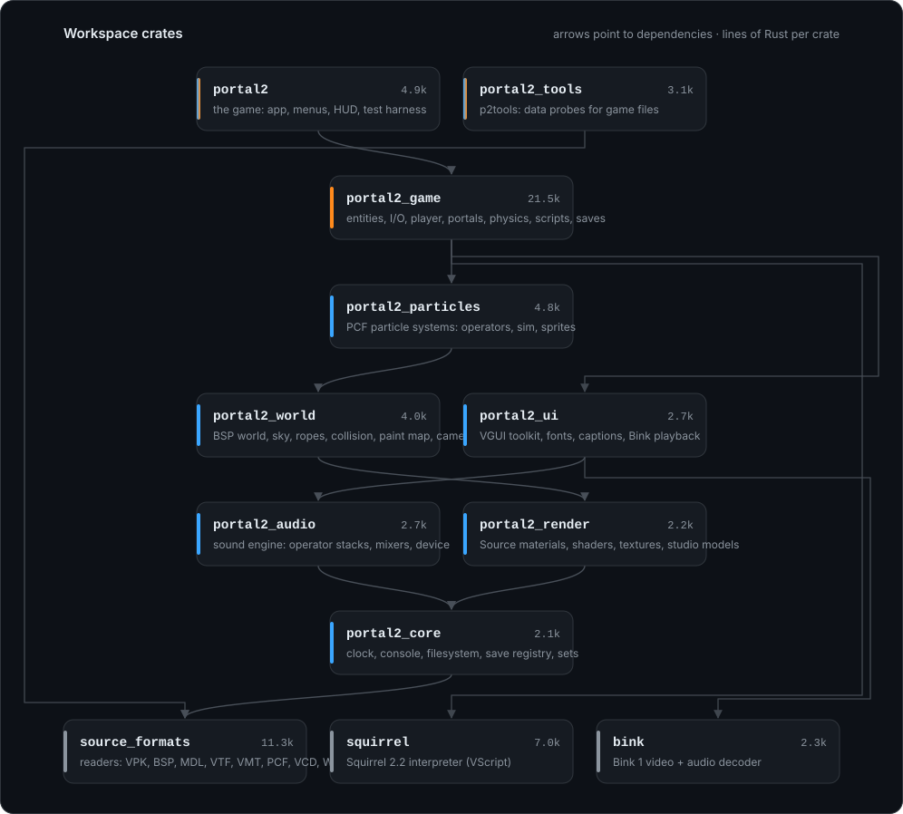
</picture>

| Crate | What it is |
| --- | --- |
| [`source_formats`](crates/source_formats) | Readers for Source formats: VPK, BSP, MDL/VVD/VTX/PHY, VTF, VMT, KeyValues, FGD, PCF, VCD, WAV, sound scripts, captions. No Bevy. |
| [`squirrel`](crates/squirrel) | A Squirrel 2.2 interpreter: lexer, compiler, VM, standard library and VM snapshots for saved games. No Bevy. |
| [`bink`](crates/bink) | A pure Rust Bink 1 video and audio decoder. No Bevy. |
| [`portal2_core`](crates/portal2_core) | The tick clock, the console, the game filesystem, the save registry, the system sets that order every frame, and the shared vocabulary. |
| [`portal2_render`](crates/portal2_render) | Source materials as Bevy materials, the texture cache, studio models with animation and lighting, and all WESL shaders. |
| [`portal2_audio`](crates/portal2_audio) | The sound engine: sound scripts, operator stacks, mixers and the output device. |
| [`portal2_ui`](crates/portal2_ui) | The VGUI toolkit (schemes, layouts, GDI fonts, painter), close captions and Bink playback. |
| [`portal2_world`](crates/portal2_world) | Map loading, the sky, ropes, the collision world, portal geometry, the paint map and the main camera. |
| [`portal2_particles`](crates/portal2_particles) | The particle engine: `.pcf` definitions, simulation and SpriteCard rendering. |
| [`portal2_game`](crates/portal2_game) | Gameplay: entities and I/O, the player, physics, portals, devices, gels, VScript, saves. |
| [`portal2`](crates/portal2) | The application: plugin assembly, menus, HUD and the test harness. |
| [`portal2_tools`](crates/portal2_tools) | `p2tools`, sixty command-line probes into the game's files. |

Every gameplay tick follows the original server's frame:

<picture>
  <source media="(prefers-color-scheme: dark)" srcset="docs/assets/tick-dark.svg">
  <source media="(prefers-color-scheme: light)" srcset="docs/assets/tick-light.svg">
  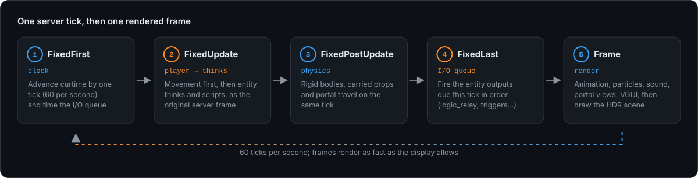
</picture>

<picture>
  <source media="(prefers-color-scheme: dark)" srcset="docs/assets/stats-dark.svg">
  <source media="(prefers-color-scheme: light)" srcset="docs/assets/stats-light.svg">
  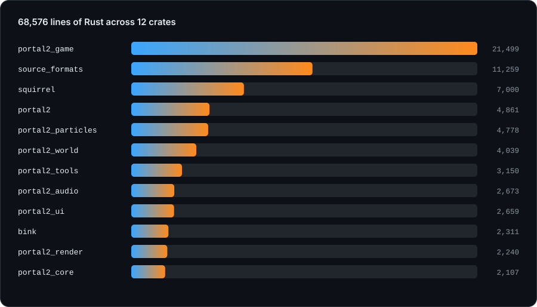
</picture>

## 🤖 How it was built

This project was built with heavy use of AI. Most of the code was written by
[Claude](https://www.anthropic.com/claude) through [Claude Code](https://claude.com/claude-code),
directed and reviewed by a human: most commits carry Claude as a co-author. The game's own binaries
were studied with [IDA Pro](https://hex-rays.com/ida-pro) (through an MCP server, so the AI could
query the disassembly directly) to learn facts the engine needs: console-variable defaults, gameplay
constants, file layouts, the order in which things happen in a frame.

<picture>
  <source media="(prefers-color-scheme: dark)" srcset="docs/assets/workflow-dark.svg">
  <source media="(prefers-color-scheme: light)" srcset="docs/assets/workflow-light.svg">
  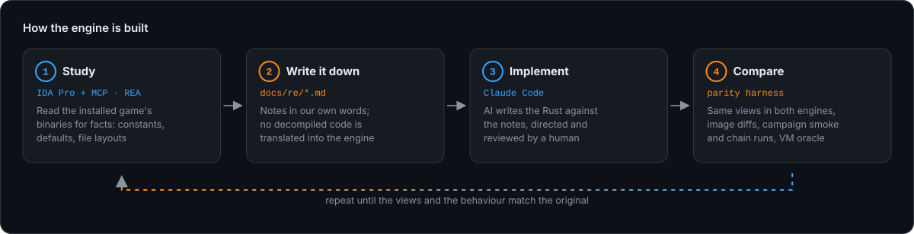
</picture>

- **Facts, not code.** What the reverse engineering found is written up in our own words in
  [`docs/re`](docs/re) (24 notes, from the particle simulation to the save format); decompiled code
  is never translated into the engine.
- **Measured against the real game.** [`re/tools`](re/tools) drives the installed game over its
  password-protected network console to capture reference screenshots and to run VScript snippets in
  its VM, then compares them with ours (your settings files are backed up and restored).
- **The whole campaign as a test.** `--smoke sp` loads every single-player map and reports script
  errors and inputs nothing handles; `--chain` rides each level's exit and checks that the map's own
  logic changes to the right next level; `--save-test` round-trips saved games.

## 📍 Status

Every single-player map loads and runs its scripts without errors, the campaign's level transitions
chain from map to map, and the ending credits roll; what remains is mostly set pieces and polish.
Milestones so far:

| | Milestone | |
| --- | --- | --- |
| M0 | Foundations: tick clock, console, parity harness | ✅ |
| M1 | Squirrel 2.2 virtual machine | ✅ |
| M2 | VScript bindings | ✅ |
| M3 | Campaign flow: level changes, trains, templates, fades | ✅ |
| M4 | Sound: operator stacks, mixers, soundscapes | ✅ |
| M5 | Choreographed scenes, captions, gestures, pose parameters | ✅ |
| M6 | Saved games | ✅ |
| M7 | Interface: VGUI, HUD, menus, Bink video | ✅ |
| M8 | Visual parity: overlays, sky, ropes, projected textures, tone mapping | ✅ |
| M9 | Particle systems | ✅ |
| M10 | Gameplay parity: movement, carrying, fizzling, turrets, portal rendering | ✅ |
| M11 | Set pieces: gels, credits, finale | 🚧 |

Not there yet: room DSP and sound occlusion, the options and save dialogs, bloom and color
correction, real-time water reflections, and some finale set pieces.

## 🛠 Development

```bash
cargo test --workspace                          # tests; the ones that read game files skip without an install
cargo run --profile fast -p portal2             # optimised build without LTO, quick to rebuild
cargo run -p portal2 --features trace           # also write a Chrome trace of every system's timings
cargo run --release -p portal2_tools -- help    # the p2tools probes
python -I docs/assets/generate.py               # redraw the README's diagrams from the workspace
```

<details open>
<summary><strong>Build and frame times</strong></summary>

<br>

Measured on the author's machine (16 threads, Windows 11, Rust 1.98) before and after the workspace
was split into crates and its build trimmed (LLD linking, line-table debug info, only the Bevy
features the engine uses):

| | Before | After |
| --- | ---: | ---: |
| Clean debug build | 10 min 32 s | **5 min 4 s** |
| Rebuild after changing a gameplay function | 69 s | **24 s** |
| Rebuild after changing a HUD function | 68 s | **22 s** |
| Build the tests (dependencies already built) | 42 s | **13 s** |
| Clean release build | 9 min 15 s | **5 min 20 s** |
| Crates compiled from scratch | 516 | **399** |
| Debug info for the game (PDB) | 1.84 GB | **155 MB** |

Frames are bound by Bevy's render thread, so most views run as before; portal views now pause while
neither portal is in sight:

| Release build, vsync off, median of 3 interleaved runs | Before | After |
| --- | ---: | ---: |
| Both portals open, behind the camera | 16.7 ms | **15.0 ms** |
| Both portals open, in view | 13.2 ms | **12.1 ms** |
| Lasers and an emancipation grill | 16.0 ms | 15.5 ms |
| A stream of paint blobs | 19.0 ms | 19.1 ms |
| A large underground vista | 16.8 ms | 16.6 ms |

</details>

<details>
<summary><strong>Parity, campaign and benchmark runs</strong></summary>

```bash
python -I re/tools/capture.py re/shots/chapter1.txt              # reference shots from the real game
cargo run --release -p portal2 -- --shots re/shots/chapter1.txt  # the same views in portal2rust
python -I re/tools/imgdiff.py re/out/ref re/out/ours re/out/diff # compare
python -I re/tools/splitview.py <original> <ours> <out.webp>     # one split-view image

cargo run --release -p portal2 -- --smoke sp                     # every single-player map
cargo run --release -p portal2 -- --chain sp_a1_intro1           # ride the campaign's level exits
cargo run --release -p portal2 -- --bench re/shots/bench.txt     # frame times at four views
```

A shot line is `name map x y z pitch yaw roll [console commands]`; see [`re/shots`](re/shots).
Copies of game binaries and analysis databases used during reverse engineering live in `re/bin/`,
which is git-ignored and must never be committed. When working in several git worktrees, pointing
`CARGO_TARGET_DIR` at one shared folder avoids building every dependency again in each.

</details>

## ⚖️ Legal

portal2rust is not affiliated with, endorsed by or sponsored by Valve Corporation. Portal, Portal 2,
Source and Steam are trademarks of Valve Corporation. This repository contains no game content: no
maps, models, textures, sounds, scripts, text or code from the game. You need your own copy of
Portal 2 to run it. Screenshots and clips in this README show the engine running the author's own
copy.

## 📄 License

Licensed under either of [Apache License, Version 2.0](LICENSE-APACHE) or [MIT license](LICENSE-MIT)
at your option.

<div align="center">
<sub>Made with Rust, Bevy, a lot of Claude, and IDA Pro.</sub>
</div>
