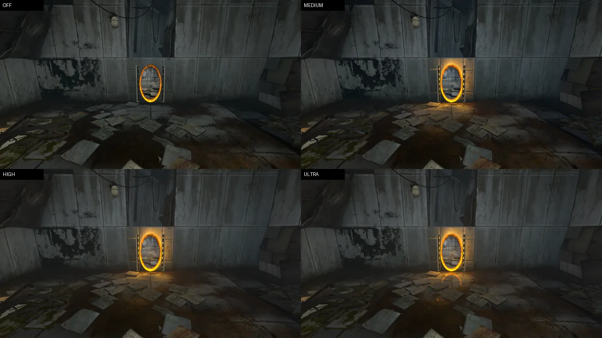
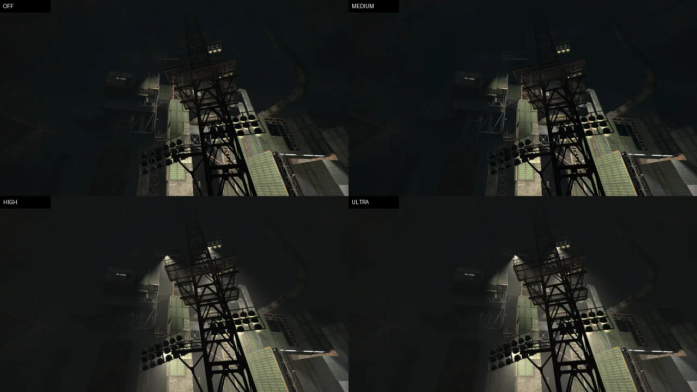
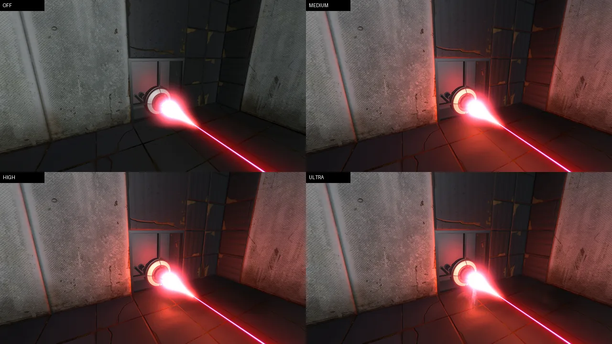
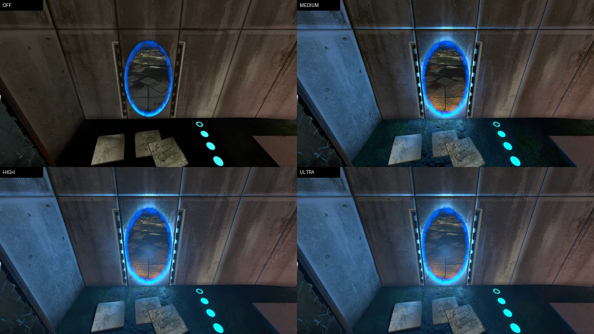
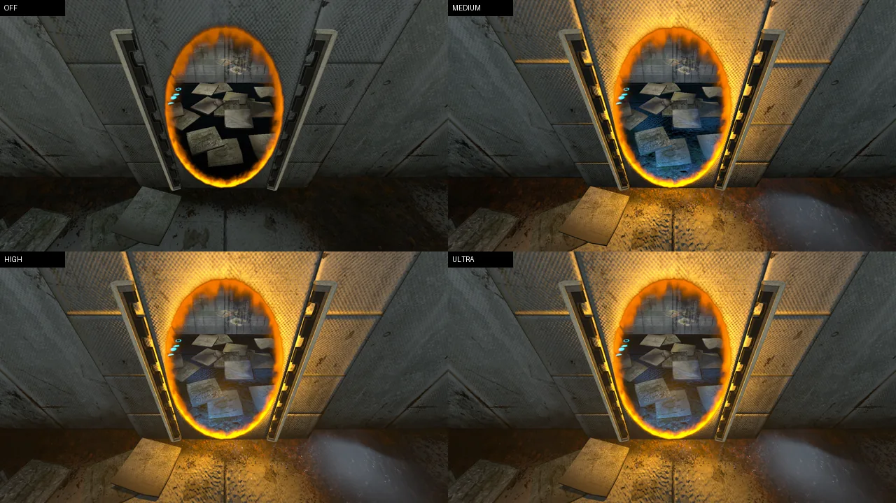
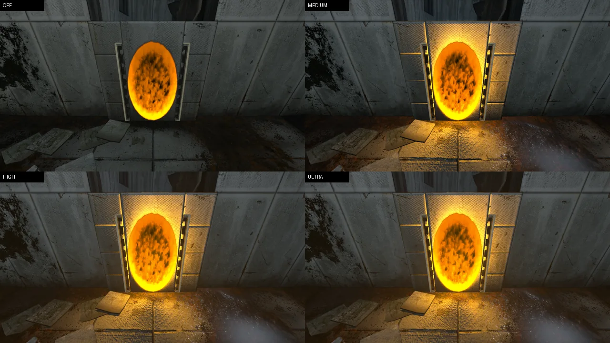
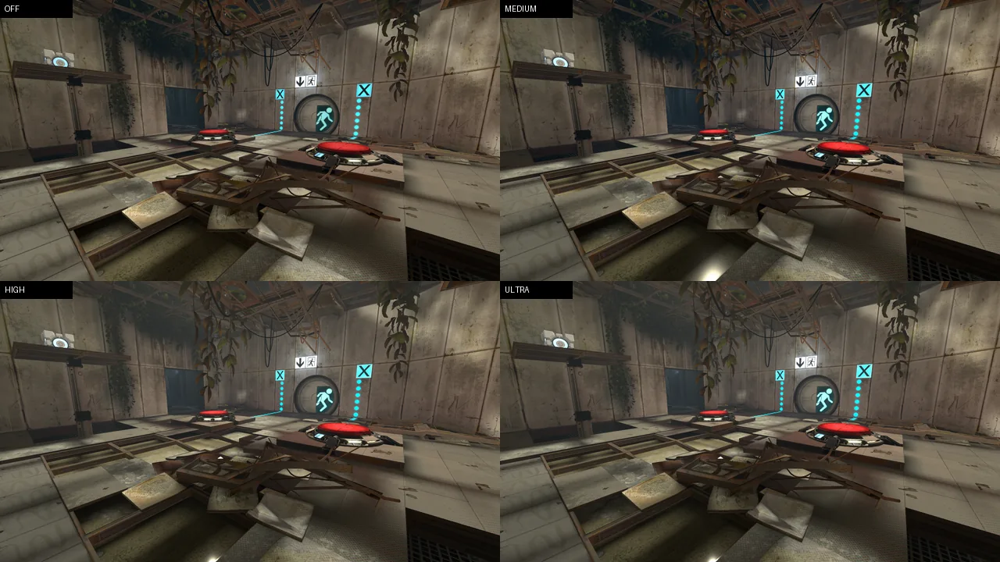

# Visual overhaul

An optional layer of real-time lighting, reflections, atmosphere and post-processing over
portal2rust's Source-faithful renderer, art-directed by seven reference scenes (an orange-lit
portal chamber, a floodlit industrial shaft, a red laser, blue and orange portals, an unlinked
portal full of fire, and an overgrown chamber). It changes nothing in the game's files or rules:
every original asset is read from the installed game as before, and only Rust code, WESL shaders
and runtime GPU data were added.

With the preset off, every material compiles exactly the shaders it had before, and the picture
matches captures taken before the overhaul (see [Verification](#verification)).

## Controls

| | |
| --- | --- |
| `r_fx_preset 0..3` | off, medium, high, ultra (default) |
| `--fx off\|medium\|high\|ultra` | the same on the command line (applied after `fx.cfg`) |
| `r_fx_<feature> -1\|0\|1` | follow the preset, force off, force on |
| `r_fx_save` | writes the `r_fx_*` values to `fx.cfg` beside the saves (`%LOCALAPPDATA%\portal2rust`), which runs at startup |

Features: `lights`, `shadows`, `ao`, `ssr`, `wetness`, `fog` (haze), `volumetrics`, `bloom`,
`grade` (tone curve and grade), `emissive`, `foliage`, `reflections` (probe reflections) and
`procedural` (portal flicker, drifting dust).

| Feature | Off | Medium | High | Ultra |
| --- | :-: | :-: | :-: | :-: |
| Portal, laser and fixture lights | | 16 | 32 | 64 |
| Portal light shadows | | | 2 maps, redrawn when moved, else every 12th frame | 4 maps, every frame |
| Ambient occlusion | | | 0.35 | 0.4 |
| Wet patches, probe reflections, haze, foliage light | | yes | yes | yes |
| Volumetric light | | | 24 steps | 48 steps |
| Screen-space reflections | | | | yes |
| Bloom, tone curve, grade, emissive boost | | yes | yes | yes |

## How it works

All of it lives in `crates/portal2_game/src/visuals/fx/` (the systems) and
`crates/portal2_render/src/{fx.rs, surfaces.rs, fx_surfaces.txt, shaders/fx*.wesl}` (the GPU side),
following the pattern the projected textures already used: one storage buffer every world and
model material binds, with the shaders reading it.

| Part | Files | What it does |
| --- | --- | --- |
| Settings | `fx/mod.rs` | `FxSettings` from the cvars, extracted to the render world; `fx.cfg`; `--fx` |
| Material variant | `fx/material.rs`, `portal2_render/src/fx.rs`, `source_material.rs` | the shared buffer (switches, lights, probes) and the `FX` shader variant, swapped in and out with the preset |
| Lights | `fx/lights.rs`, `fx/portal_light.rs`, `shaders/fx.wesl` | portals as one-sided elliptical area lights, lasers as tube lights plus emitter and impact, the world-light lump's fixtures as highlights only; scored, budgeted, shaded with representative points and GGX |
| Shadows | `fx/shadows.rs` | wide distance maps from the portals, drawn like the projected textures' ones, redrawn on demand |
| Occlusion | `fx/screen.rs`, `shaders/fx_ao.wesl` | depth-based hemisphere occlusion on the main view after the opaque pass |
| Surfaces | `portal2_render/src/surfaces.rs`, `fx_surfaces.txt` | data-driven profiles: roughness, reflectance, wet eligibility, foliage, emissive share |
| Wetness, reflections | `shaders/fx.wesl`, `fx/reflections.rs` | world-space wet patches; the map's own baked cube maps in one cube array |
| Atmosphere | `fx/atmosphere.rs`, `shaders/fx_volumetric.wesl` | haze coloured by the map's ambient light; volumetric scattering from projected textures, volumetric lights and ambient haze, on the main view and the portals' views, softly limited so no room fills with smoke |
| Screen-space reflections | `fx/ssr.rs`, `shaders/fx_ssr.wesl` | puddles reflect the scene, portals and beams included (ultra) |
| Post | `fx/postfx.rs`, `shaders/fx_post.wesl` | bloom, identity-below-the-knee tone curve, grade, dither |

Design decisions worth knowing:

- **Baked light is not added twice.** The map's fixtures (`light`, `light_spot`, luminous
  textures) are already in the lightmaps and the cube maps, so they only add highlights on glossy
  surfaces, scaled by how much of their light the lightmap shows at the pixel (an occlusion test
  for free). Only emitters the compiler never saw (portals, lasers) add diffuse light. Dynamic
  models skip fixtures entirely: they already get them through their own world lights.
- **Bevy's own post-processing could not be used as is.** Every camera runs `Tonemapping::None`
  with the game's auto-exposure applied in the shaders, there is no prepass and the materials
  are custom, so Bevy's SSAO (which needs `Msaa::Off`), SSR (which needs deferred materials),
  volumetric fog (which needs Bevy lights) and colour grading (which only runs inside its
  tonemapping pass) do not fit. The overhaul has its own passes instead.
- **Main-view passes blend into the multisampled scene.** The window's cameras share one
  multisampled texture, and every later camera resolves it over the main texture again, so the
  main camera's occlusion, reflections and volumetrics are drawn into its multisampled attachment
  with blending (`out = add + dst × mul`). Occlusion lands before glass, beams and the portals'
  openings are drawn; volumetrics before the viewmodel.
- **Portal views stay consistent.** Everything done in the materials (lights, wetness, probe
  reflections, haze) is the same in the portals' views, and the portals' first-level views run
  the volumetric light too, so the air looks the same through an opening as after stepping
  through it. Occlusion, screen-space reflections and the post chain run once, on the main view
  and the final picture.
- **The air never turns to smoke.** In-scattered light saturates toward a fixed brightness;
  lights within a few metres of the eye (an elevator's lamp overhead) light the view, not the air
  in it; and temporary `r_flashlightbrightness` boosts (the first map's container ride raises it
  twelvefold) brighten surfaces as in the game but not the volumetrics.
- **No temporal filter.** Noise in the occlusion and volumetrics uses a fixed per-pixel pattern
  and spatial filtering; the 4× MSAA stays, and highlights get specular antialiasing. Nothing can
  ghost behind moving objects or portal crossings.

## The reference scenes

Each picture shows the same view at off, medium, high and ultra (`re/shots/visual_overhaul.txt`;
the views are this engine's own framings of the references). The references' targets were partly
AI-generated with invented geometry, windows and lamps, so the comparison is about the qualities
they ask for, not their pixels; nothing was added to the levels.

**00 Portal chamber** (`sp_a1_intro2`). The orange portal's rim lights the frame and wall around
it and pools warm light on the floor and the papers in front of it, falling off with distance and
blocked by what stands in front (high and ultra shadow it). Wet patches on the concrete pick up
the glow.



**01 Industrial shaft** (`sp_a3_jump_intro`). The floodlight spotlights (from the map's own
world lights) throw faint volumetric cones; the void, which drew as flat black, now reads as air
with a haze coloured by the map's ambient light. The real game fogs this space more strongly
through map logic that switches fog controllers; that difference predates the overhaul.



**02 Red laser** (`sp_a2_fizzler_intro`). The emitter and the beam (as a tube light along its
whole length) cast red light on the floor, the panel and the walls near them; the glow blooms
without clipping to white.



**03 Blue portal** and **04 Orange portal** (`sp_a1_intro2`). Strong coloured spill on the frame,
the walls beside the portal and the floor, consistent through the other portal's view; wet
patches carry highlights and, on ultra, screen-space reflections of the rim. The cyan floor
indicators glow without washing out.




**05 Unlinked portal** (`sp_a1_intro2`). The game's own static fill (shown whenever a portal is
unlinked or its partner has just moved) stays as it was; it is now brighter as a light source, so
the wall and floor glow harder than for a clear portal. A linked portal is always see-through.



**06 Overgrown chamber** (`sp_a1_intro4`). Haze and soft shafts from the chamber's projected sun
through its real openings, vines lit through from behind, wet patches between the tiles, contact
occlusion under the debris, glowing signs and indicators. The real game shows this chamber's sun
patches brighter than this engine does at the overhaul's off setting too; that is a difference
in how bright the projected texture is drawn, not something the overhaul adds or hides.



## Verification

- `cargo fmt --all --check`, `cargo clippy --workspace --all-targets -- -D warnings` and
  `cargo test --workspace` pass (new tests: preset resolution, tone curve, light packing and
  scoring, portal light energy and flicker, surface profiles, probe mip layout, haze colour).
- **Off is the faithful picture.** Captures of the seven views with `--fx off` against captures
  from the build before the overhaul (`re/tools/imgdiff.py`): static views differ by 0.00 mean
  absolute error; views with portals by at most 0.21, within what two runs of the old build differ
  by (up to 0.42: the rims animate).
- **All single-player maps** load and run at high (`--smoke sp`): 63 maps, no script errors, no
  panics or GPU validation errors. Save round trips (`--save-test`) match on three maps; the
  overhaul adds nothing to saves (portal lights, laser lights, probes and fixtures are rebuilt from
  the game state).
- **Motion and portal crossings**: `--record` with `--autopilot` walking through the
  `sp_a1_intro2` portal pair at high and ultra; frames before, during and after the crossing show
  the lighting continuous through the opening, with no ghosting (there is no temporal filter) and
  no popping. A NaN at the screen's edge in the occlusion pass, which bloom spread into a black
  block after one crossing, was found this way and fixed.
- **Parity checks against the real game** (`re/tools/capture.py`, same views): three suspected
  bugs in the faithful renderer (colour tints used without the engine's gamma-to-linear step, sky
  and water fog colours divided by 255 twice, `env_cubemap` brushes and water without a cube
  map) were tested. Linearising the tints moved the error both ways (mean 11.04 to 11.02), so it
  was not confirmed and nothing was changed; the other two do not appear in these views. They are
  left as they were in every preset; the overhaul's probe reflections give `env_cubemap` surfaces
  a reflection when it is on.

Reproduce:

```bash
cargo run --profile fast -p portal2 -- --shots re/shots/visual_overhaul.txt --shots-out re/out/fx/high --shot-settle-time 4 --shot-map-settle 12 --fx high
cargo run --profile fast -p portal2 -- --bench re/shots/visual_overhaul.txt --bench-out re/out/fx/bench_high.txt --shot-map-settle 8 --shot-settle-time 3 --fx high
python -I re/tools/imgdiff.py re/out/fx/before re/out/fx/off re/out/fx/diff
```

## Performance

Median frame time in milliseconds at 1600×900, `fast` profile, vsync off, RTX 5060 Ti and
Ryzen 7 8700F, two interleaved runs each:

| View | Off | High | Ultra |
| --- | ---: | ---: | ---: |
| Unlinked portal | 3.2 | 3.7 | 6.5 |
| Portal chamber (both portals, linked) | 12.4–12.7 | 13.3–13.6 | 17.7 |
| Orange portal | 11.0 | 11.9–12.0 | 16.5 |
| Blue portal | 10.7 | 11.8–12.0 | 16.1–16.4 |
| Industrial shaft (157 fixtures) | 9.8 | 11.9–12.1 | 18.2–18.5 |
| Red laser | 13.5–14.7 | 14.9–15.7 | 14.3–14.4 |
| Overgrown chamber | 15.0–16.6 | 17.2 | 17.1 |

Medium costs nothing measurable over off. Frames here are bound by the render thread's work per
camera view, so the expensive part of the overhaul is its extra views: each shadow map is a full
scene pass, which is why high redraws them only when a light moves (and every twelfth frame to
follow props), and why ultra (which redraws them every frame) costs most in portal views. On
ultra the 48-step volumetrics are the other big cost in huge, light-filled spaces. Runs are
noisy: Windows sometimes throttles a background window to 60 Hz, which shows as 16.7 ms; such
runs were repeated.

Ultra is the default (it suits a GPU of this class at 1440p); **high** where frames are tight in
portal-heavy rooms, **medium** on weaker GPUs (all the material-side effects, no extra views or
screen-space passes). Ultra's volumetrics also run in the two portal views when a linked pair is
on screen, about 1 ms more there.

## Limitations

- The references' targets were generated with geometry the levels do not have (extra windows,
  lamps, puddles in particular places, a different camera); the overhaul only lights what is
  there, so views match their mood, not their layout. Wet patches come from world-space noise and
  material profiles, not from art placed per room.
- Sun shafts come from the projected textures most chambers use for their sun; maps whose sun is
  only a `light_environment` get no shafts from it (no sun shadow map).
- Screen-space reflections cannot show what is off screen; the probe reflection remains there.
  Probes are picked by distance, as the engine does for models, so a probe behind a wall can be
  chosen.
- Unshadowed volumetric spotlights can extend through thin geometry beside their cone; their
  share is kept low for that reason.
- Foliage is not animated by wind: the models use Bevy's vertex shader and a wind variant was left
  out to keep the skinned and static paths untouched.
- Occlusion and screen-space reflections run on the main view only; through a portal the
  materials' effects and the volumetric light match, those two do not. The second, recursive
  portal view gets no volumetrics.
- Stepping through a portal shows one black frame at the crossing. That predates the overhaul (it
  happens identically with it off and in the build before it).

## Game files and gameplay

No original asset was modified, exported or replaced: maps, textures, materials and models are
read from the installed game exactly as before, and the only file the overhaul writes is
`fx.cfg` in portal2rust's own data folder (`r_fx_save`). Nothing in collision, movement, portal
placement or traversal, lasers, puzzles or entity logic changed: the overhaul reads the portals'
and lasers' state (`Portal`, `LaserEmitter::segments`) and the map's lights and probes, and only
the portal shader gained a brightness multiplier that is 1 when the overhaul's emissive feature is
off. The save round trips and the full smoke run above confirm the game behaves the same.
